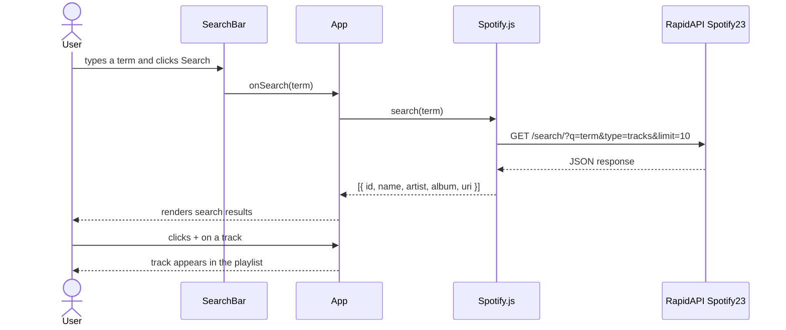

# Jammming

Jammming is a React web application for searching songs via Spotify, building a custom playlist and clearing it when you are done. The search is powered by the RapidAPI Spotify23 wrapper.

## Motivation

Jammming is a project in the Full-Stack Engineer path at Codecademy, built to practice React: components, state with hooks and passing data through a component tree.

The plan was to use Spotify's official Web API to save playlists to the user's account, but Spotify requires Premium for write operations. I switched to RapidAPI, which offers free search without OAuth. The trade-off is that playlists can't be saved to Spotify, so Save only clears the playlist locally (see [Future work](#future-work)).

## Development approach

I started by breaking my project down into abstract epics. These epics were later associated with issues that together defined each epic's *definition of done*.

During the project I adopted a test-driven workflow. Unit tests were generated using the AI tool [agent-instructions](https://github.com/wbern/agent-instructions). I instructed the AI to produce one failing test at a time, following the Red phase of the Red–Green–Refactor cycle; it was then my responsibility to make the test pass. If I got stuck, I asked my AI agent to guide me using a Socratic approach.

This method reinforced the discipline of implementing focused, incremental changes and helped me form a clear understanding of each component's expected behavior before writing any production code.

## Features

- **Search for songs**: enter a search term and get up to 10 results from Spotify via RapidAPI
- **Add to playlist**: click `+` to add a song; duplicates (matched by track `id`) are ignored
- **Remove from playlist**: click `-` to remove a song
- **Rename the playlist**: edit the name directly in the input field
- **Save and clear**: click Save to reset the playlist (local only, see [Motivation](#motivation))
- **Responsive layout**: two columns (results and playlist) that collapse to one column on narrow screens

## Tech/framework used

**Built with:**

- [React](https://react.dev/) 19 with hooks (`useState`)
- [Vite](https://vite.dev/) as build tool and dev server
- [RapidAPI Spotify23](https://rapidapi.com/) (`spotify23.p.rapidapi.com`) for track search
- Plain CSS

**Tested with:**

- [Vitest](https://vitest.dev/) with the `jsdom` environment
- [@testing-library/react](https://testing-library.com/docs/react-testing-library/intro/), `@testing-library/user-event` and `@testing-library/jest-dom`

## Sequence diagram



## Code style

- [ESLint](https://eslint.org/) with `@eslint/js`, `eslint-plugin-react-hooks` and `eslint-plugin-react-refresh` (run with `npm run lint`)
- Commit messages follow [Conventional Commits](https://www.conventionalcommits.org/)
- No Prettier or EditorConfig is configured

## Installation

1. Clone the repository:
   ```bash
   git clone git@github.com:hevolx/Jammming.git
   cd Jammming
   ```
2. Install dependencies:
   ```bash
   npm install
   ```
3. Get an API key for the Spotify23 API on [RapidAPI](https://rapidapi.com/).
4. Copy `.env.example` to `.env.local` and set your key:
   ```bash
   cp .env.example .env.local
   ```
   ```
   VITE_RAPIDAPI_KEY=your-rapidapi-key
   ```
5. Start the dev server:
   ```bash
   npm run dev
   ```
   Open the URL printed by Vite (usually http://localhost:5173).

Other scripts: `npm run build` (production build) and `npm run preview` (preview the build).

## Tests

```bash
npm test             # watch mode
npm test -- --run    # run once
```

The tests cover `App` (search, add, remove, save), each component (`SearchBar`, `SearchResults`, `Playlist`, `Tracklist`, `Track`) and the `Spotify` search module.

## Usage examples

1. Type a song or artist, for example `Queen`, in the search field and click **Search**.
2. Click **+** next to a result to add it to the playlist on the right.
3. Edit the playlist name in the input field at the top of the playlist.
4. Click **-** to remove a track, or **Save** to clear the playlist.

## API reference

The app has no backend of its own. It calls one external endpoint:

| Method | URL | Auth | Description |
| ------ | --- | ---- | ----------- |
| GET | `https://spotify23.p.rapidapi.com/search/?q={term}&type=tracks&limit=10` | `x-rapidapi-key` header | Searches Spotify tracks. The response is mapped to `{ id, name, artist, album, uri }`. |

## Environment variables

| Name | Required | Description |
| ---- | -------- | ----------- |
| `VITE_RAPIDAPI_KEY` | Required | Your RapidAPI key, sent as the `x-rapidapi-key` header in search requests. |

## Future work

- **Spotify OAuth**: log in with a real Spotify account via the Implicit Grant Flow to save playlists directly to the account
- **Error handling**: show error messages if the search fails or the API key is missing
- **Clear search results after Save**: also reset the results when the playlist is saved